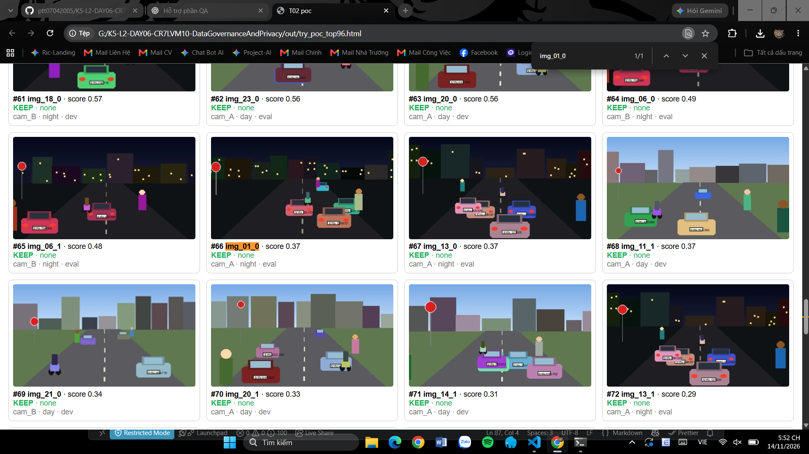
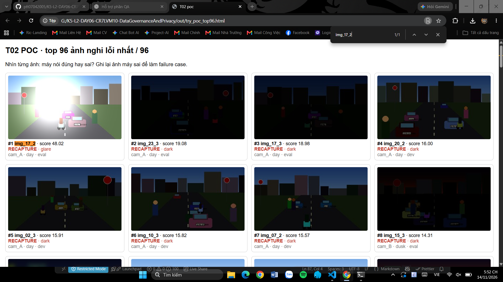
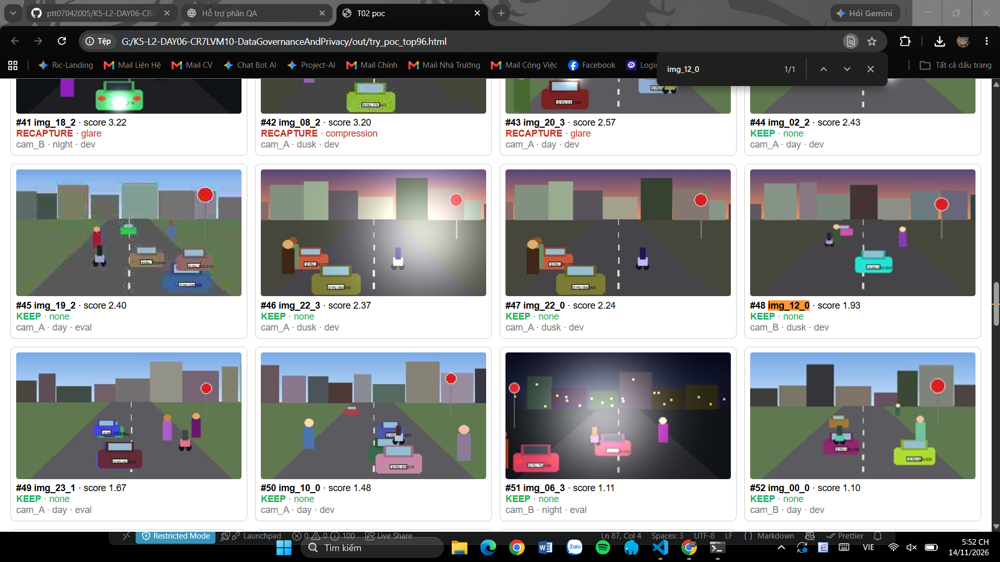

# Group Report — Day 06 Data Lab (Field-to-Release PoC)

> Điền đầy đủ, cụ thể, không viết chung chung. Mọi con số phải lấy từ file do script sinh ra
> (`reports/metrics_*.json`, `reports/table1_baseline_vs_poc.md`) — không gõ tay, không làm tròn mất đơn vị.
> 3–5 trang (hoặc README + report.md tương đương).

## 00 · Header

| Mục | Giá trị |
|---|---|
| Group ID | G__ |
| Challenge | T__ · ______________________ |
| Thành viên (5–6) + vai trò | 1. ____ (Lead/Integrator) · 2. ____ (Data & fixtures) · 3. ____ (Core algorithm) · 4. ____ (QA/metric) · 5. ____ (Review + report) · 6. ____ |
| Git URL | ____ |
| Tag `demo-180m` (commit) | ____ |
| Tag `final-24h` (commit) | ____ |
| Deadline (giờ VN) | ____ |

## 01 · Problem statement

- Ai bị ảnh hưởng / ai chịu hậu quả khi hệ thống sai? ____
- Điểm nghẽn cụ thể: ____
- Đầu vào → đầu ra: ____
- Tiêu chí GO / HOLD / REWORK (chốt trước khi chạy eval): ____
- Giả định của nhóm (cần DPO/legal/domain owner xác nhận): ____

## 02 · Data & provenance

| Split | N | Nguồn / link | License | Synthetic? |
|---|---|---|---|---|
| dev | | | | |
| eval / heldout | | | | |

- Schema & class mapping: ____
- Seed: 42 · Cách chia split (theo scene/group/segment?): ____
- `manifest.csv` verified (sha256): có / không — lệnh: `python -m tools.verify_manifests`
- Dữ liệu thật dùng (nếu có) và cách xây GT cho nó: ____

## 03 · Research & design

- 2–3 references (URL + ngày xem) và **vì sao** chọn kỹ thuật: ____
- Sơ đồ data flow (input → process → rank/QC → review → decision → report): ____
- Thành phần offline (model/weights + checksum + license nếu có): ____
- Trade-offs đã cân nhắc: ____

## 04 · Baseline vs PoC

- Baseline (mô tả, version/config, commit): ____
- PoC (mô tả, version/config, commit): ____
- Cùng budget / cùng heldout / cùng seed: xác nhận ____

**Bảng 1 · Baseline vs PoC & hard slices** — dán output của
`python -m src.compare reports/metrics_baseline.json reports/metrics_poc.json`:

| Metric (unit) | Baseline | PoC | Δ & chú thích |
|---|---|---|---|
| Primary: ______ | ____ | ____ | ____; higher/lower? |
| Hard-slice: ______ | ____ | ____ | ____; N=__ |
| Review@B / miss / FP | ____ | ____ | ____; B=__ |
| Runtime / 100 items | ____ | ____ | ____; CPU=__ |

## 05 · Evaluation protocol

- Công thức primary metric, đơn vị đánh giá, TP/FP/FN, denominator: ____ (xem `reports/metric_contract.md`)
- Threshold / budget B / K và lúc chốt: ____
- Độ bất định (CI/bootstrap/variance) khi N nhỏ: ____
- Lệnh evaluate chính xác: `python -m src.evaluate --track t__ --pred ... --out ...`

## 06 · Result slices

### 06.1 · Ba failure mode bắt buộc

#### Failure case 1 — Nguy cơ loại nhầm ảnh đêm hợp lệ

- **Ảnh minh họa:** `img_01_0`
- **Metadata:** `camera_id=cam_A`, `light=night`, `split=eval`
- **Kết quả PoC:** `score=0.37`, `pred_action=KEEP`, `pred_defect_type=none`
- **Phân tích:** Ảnh được chụp ban đêm nên độ sáng trung bình thấp, nhưng phương tiện, làn đường và các chi tiết quan trọng vẫn quan sát được. Nếu sử dụng một ngưỡng độ sáng chung cho cả ảnh ngày và ảnh đêm, ảnh này có nguy cơ bị nhận nhầm là lỗi thiếu sáng.
- **Root cause:** Thuật toán đơn giản dễ đánh đồng điều kiện ánh sáng ban đêm tự nhiên với lỗi underexposure.
- **Biện pháp:** PoC chuẩn hóa đặc trưng `dark` theo trường `light`, giúp so sánh ảnh đêm với nhóm ảnh đêm thay vì trực tiếp với ảnh ban ngày.



#### Failure case 2 — Baseline bỏ sót lóa cục bộ

- **Ảnh minh họa:** `img_17_2`
- **Metadata:** `camera_id=cam_A`, `light=day`, `split=eval`
- **Kết quả baseline:** `score=-6.16`, `pred_action=KEEP`, `pred_defect_type=none`
- **Kết quả PoC:** `score=48.02`, `pred_action=RECAPTURE`, `pred_defect_type=glare`
- **Phân tích:** Ảnh còn nhiều cạnh rõ nét nhưng một vùng lớn bị cháy sáng. Baseline chỉ dùng Laplacian toàn ảnh nên không phát hiện được lỗi lóa này.
- **Root cause:** Đặc trưng toàn ảnh làm vùng lóa cục bộ bị trung bình hóa; baseline cũng không có đặc trưng đo tỷ lệ pixel bão hòa.
- **Biện pháp:** PoC chia ảnh thành lưới và lấy tỷ lệ pixel bão hòa lớn nhất ở từng ô để phát hiện glare cục bộ.



#### Failure case 3 — Camera bias đối với cam_B

- **Ảnh minh họa:** `img_12_0`
- **Metadata:** `camera_id=cam_B`, `light=dusk`, `split=dev`
- **Kết quả baseline:** `score=-5.14`, `pred_action=RECAPTURE`, `pred_defect_type=blur`
- **Kết quả PoC:** `score=1.93`, `pred_action=KEEP`, `pred_defect_type=none`
- **Phân tích:** Ảnh vẫn sử dụng được nhưng baseline đánh giá là mờ vì cam_B có đặc tính quang học mềm hơn cam_A.
- **Root cause:** Một ngưỡng Laplacian chung cho tất cả camera tạo ra thiên lệch đối với camera có độ sắc nét tự nhiên thấp hơn. Trong kết quả baseline, tỷ lệ `RECAPTURE` ở lát cắt `cam_B/dusk` là `5/8 = 62%`, trong khi `cam_A/dusk` chỉ là `1/12 = 8%`.
- **Biện pháp:** PoC chuẩn hóa đặc trưng blur theo từng `camera_id` bằng median và MAD, tránh so sánh trực tiếp cam_B với cam_A.



### 06.2 · Kiểm thử trên ảnh thật theo yêu cầu Labcoach

- Dùng `tools/download_real_samples.py` tải 30 ảnh thật từ BDD100K với `seed=42` và `max_side=640`.
- Mẫu gồm 11 ảnh đêm, 8 ảnh ban ngày, 3 ảnh bình minh/hoàng hôn và 8 ảnh chưa xác định thời điểm.
- Chạy `tests/test_t02_real_samples.py`: **4 test passed**.
- Bộ test kiểm tra tính toàn vẹn manifest, mỗi ảnh được chấm đúng một lần, điểm số hữu hạn và sắp xếp đúng, tính tái lập, cùng độ phủ nhiều điều kiện ánh sáng.
- Để có nhãn kiểm thử xác định mà không đọc ground truth ẩn, nhóm dùng 18 ảnh thật làm thống kê tham chiếu và 12 ảnh thật held-out. Trên mỗi ảnh held-out, nhóm tạo bốn bản lỗi xác định (`blur`, `dark`, `glare`, `compression`), tổng cộng **48 trường hợp lỗi có nhãn**.

| Kết quả trên 48 lỗi cài vào ảnh thật | PoC | Baseline | Chênh lệch PoC |
|---|---:|---:|---:|
| Phát hiện và yêu cầu chụp lại | 42/48 (87.50%) | 33/48 (68.75%) | +18.75 điểm % |
| Dự đoán đúng loại lỗi | 40/48 (83.33%) | 12/48 (25.00%) | +58.33 điểm % |
| Điểm lỗi cao hơn ảnh gốc cùng nguồn | 48/48 (100.00%) | 29/48 (60.42%) | +39.58 điểm % |

| Loại lỗi | PoC phát hiện | PoC đúng loại | Baseline phát hiện | Baseline đúng loại |
|---|---:|---:|---:|---:|
| Blur | 12/12 | 12/12 | 12/12 | 12/12 |
| Dark | 6/12 | 6/12 | 12/12 | 0/12 |
| Glare | 12/12 | 10/12 | 3/12 | 0/12 |
| Compression | 12/12 | 12/12 | 6/12 | 0/12 |

- **Kết luận:** PoC vượt baseline rõ nhất ở khả năng phân loại loại lỗi và phát hiện glare/compression. Điểm yếu còn lại là `dark`: PoC chỉ phát hiện 6/12 trường hợp, dù cả 12 ảnh lỗi tối đều có điểm cao hơn ảnh gốc tương ứng. Đây là ưu tiên cải tiến threshold/chuẩn hóa độ sáng.
- **Giới hạn diễn giải:** BDD không cung cấp nhãn QC tự nhiên cho ảnh gốc. Vì vậy nhóm chỉ báo recall trên 48 lỗi được cài có kiểm soát; không tuyên bố precision, false-positive rate hoặc Defect Recall@20 trên ảnh BDD nguyên gốc.
- Dữ liệu ảnh thật được giữ cục bộ trong `data/real/` và không commit lên repository công khai.
- **Latency/compute:** Điền từ `out/poc/run_info.json` sau khi Member 1/2 hoàn thiện pipeline E2E.

## 07 · Human & decision

- Review queue (file, B, cách ưu tiên): ____
- Cách override + audit log (`out/audit_log.jsonl`): ____
- Decision policy + `reason_code` + owner: ____
- Khi nào HOLD/REWORK thay vì tự động release: ____

## 08 · Reproduce & tests

```bash
make setup          # hoặc: python -m venv .venv && pip install -r requirements.txt
python -m src.main --input fixtures/<track> --config configs/lab.yaml --output out/ --offline --seed 42
python -m src.evaluate --track t__ --pred out/<file> --out reports/metrics_poc.json
pytest -q
```

- Output của `pytest -q`: ____
- Máy / CPU / OS / Python: ____ · git sha: ____

## 09 · Limitations & ethics

- Rủi ro pháp lý / PII / license: ____
- Điều chưa biết; false alarms; nếu scale 10× thì sao: ____
- Không tuyên bố "đạt GDPR / luật Việt Nam" từ checklist tự động; giả định cần DPO/legal xác nhận: ____
- Kế hoạch cải tiến: ____

## 10 · Team contribution

**Bảng 2 · Individual contribution evidence** (đối chiếu với `git shortlog -sne --all` và `reports/team_contributions.csv`)

| Học viên | Git author/email | Module / vai trò | Commit SHA / diff chứng minh | Trình bày? |
|---|---|---|---|---|
| Member 1 | | Integration / CLI | | |
| Member 2 | | Data + GT | | |
| Member 3 | | Core algorithm | | |
| Member 4 | | Metric + tests | | |
| Member 5 | | Review queue + report | | |
| Member 6 (nếu có) | | Research / ablation / debate | | |

## 11 · References

| URL | Ngày xem | 1–2 dòng ý nghĩa (không chép nguyên văn) |
|---|---|---|
| | | |

---

**Bảng 3 · Checklist chốt khi nộp**

- [ ] Link repo và tag cuối cùng trong README; input mẫu không chứa PII thật.
- [ ] Đúng 1 lệnh run, 1 lệnh evaluate, 1 lệnh tests; không cần download khi chạy.
- [ ] Có baseline/PoC metrics, ≥1 failure case, reviewer evidence, decision log.
- [ ] Có license/source provenance, data splits, seed, offline environment, GT/eval N.
- [ ] Mỗi thành viên có ≥1 commit thực chất và được nêu minh bạch trong bảng trên.
